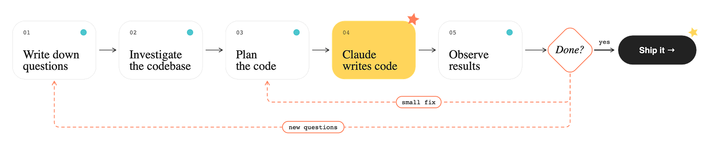

At the beginning of this semester, I got an email from [CodePath](https://www.codepath.org)¹ advertising a course titled AI301², [Applied AI Engineering: Open-Source Capstone](https://www.codepath.org/courses/applied-ai-engineering?hsLang=en). This course teaches students how to use agentic AI³ to make meaningful contributions to real open-source repos.

Since getting into SWE my first year of college, I’ve been really interested in contributing to open source, but it always seemed very far out of reach. ***I thought I’d need years and years of industry experience and be an expert in the language/stack of the project in order to make code contributions.*** Even up until this year, the start of my junior year, having gotten more SWE experience through internships, projects, and courses, I still didn’t feel qualified to make contributions.

So when I got that email from CodePath about AI301, I really wanted to take the course. For context, I’ve had previous experience with CodePath through their [tech exchange program](https://www.codepath.org/ctex). Because I had been through this program, I already knew and trusted the caliber of their organization, courses, instructors, and staff.

**But this isn’t a CodePath appreciation post!**

The things I want to focus on are:

- a summary of the course
- how it helped me take the leap and submit a PR to a real open-source repo
- the failures, challenges, and subsequent lessons I encountered along the way

## Summary of the course

### Classes

The classes were remote and split into two parts:

1. Instruction on concepts needed for the weekly assignment
2. Breakout rooms where you practice skills needed for the weekly assignment through activities with 2-4 peers in the class⁴

### Assignments

Every week there was an assignment. Almost every assignment, you’d build upon a skill or program that directly helps you contribute in some way, from finding a repo/issue to making sure your final PR passes all required checks before submission. You can, of course, use these skills after you finish the course to help make further contributions.

The first couple weeks you practice making a contribution to a [toy repo](https://github.com/codepath/pathreview-ai301-fa26-s3) created by CodePath. Then the next few weeks (the bulk of the course) are spent making a contribution to an actual repo. The last couple of weeks are spent creating artifacts/portfolio pieces based on the work you did and sharing your work with peers.

### Contribution

You can see the PR I opened in the [Home Assistant](https://www.home-assistant.io) Android repo [**here**](https://github.com/home-assistant/android/pull/7862).

I’m not gonna lie, I underestimated the amount of time this part of the course would take. Part of this is because I was treating this like I would if I were making code changes at a job: write down questions, answer questions by investigating the relevant parts of the codebase, make a plan for how to write the necessary code, **then** have Claude write the code, observe results, and repeat.

*My process for shipping code with AI⁵*

In other words, I didn’t want to vibe code my contribution.

This is for a few reasons that I want to expand upon in another article/video, but to sum it up: I want to learn how to be a great SWE and I don’t want to submit slop to a repo, which would either 1) waste the time of a maintainer or 2) risk buggy code being shipped and hurting users.

After I submitted the PR, a maintainer let me know that there was a PR in progress that would migrate the code underlying mine to a more modern framework. So my change hasn’t been merged yet, but I’m watching the other PR so when it’s merged I can rebuild my changes and submit my updated ones on top of theirs.

### Taking the Leap

After taking the course, I realized I already had most of the skills I needed. I’ve been learning a lot about software engineering and have gotten changes merged into a fairly large codebase during an internship. So although I’m not an expert and I’m always trying to improve, I can write (what I think is) solid code with tests, I can navigate through whatever GitHub/dev workflow is used in a repo, and I have a fair amount of fluency using tools like Claude Code.

The two things that this course gave me that helped me make my first contribution are structure and accountability. Without them, I don’t know if I ever would have made a contribution.

## Failures & Challenges

### Speed vs. Code Ownership

Again, this is something that I’m planning on exploring more in depth in another post/video, so I’ll keep it relatively brief.

I’ve found the following two statements to be undeniable:

1. Vibe coding and owning your code are mutually exclusive.
2. You must own your code when humans (maintainers, reviewers, and/or users) are impacted by your code.

> As an aside, I want to say that I do believe there are times when vibe coding & therefore not having meaningful ownership over your code is acceptable (throwaway code, personal projects/tooling w/ no users or low impact, etc), but submitting code to a repo with real human maintainers and/or real human users is not one of them.

> Additionally, although I’m not a senior engineer myself, it seems that more experienced/senior engineers need less effort to own their code, and therefore can lean more toward vibe coding without losing that ownership.

However, there is somewhere in between not using AI at all and vibe coding that strikes the (near-)perfect balance between speed and ownership.

During this course, I wrestled with trying to find this balance. In fact, I still am. My in-progress effort at finding this balance is a Claude Code plugin called [own-it](https://github.com/amierlorenz/own-it). It uses hooks and various .md files to make the agent only abstract away writing the code, so the rest of the software engineering process (i.e. the parts that foster ownership) is left to you, the human software engineer.

This was the first real test run of the plugin in a scenario where code ownership really matters. Throughout the process of making the contribution, I identified and recorded a lot of areas where it could be improved. I plan on implementing those improvements to the plugin and testing it further.

This plugin caused a lack of speed because owning your code is more time-consuming, and I was trying to work out the kinks of the plugin. This lack of speed played a part in in the next challenge I’ll talk about.

### Time

The main challenge I faced with this course as a whole was the time commitment. In addition to the time sinks I talked about above, I bit off more than I could chew this semester (not just with this class but with many other things) and this course is very time-consuming.

But it was and is a very big goal of mine to be able to contribute to open source, and keeping that goal in mind helped me get through the 10+ hours per week this course demands.

## What now?

I’m very happy that I took this course and very proud of myself for putting myself out there and submitting a PR. Going forward I’m going to:

- update & finish my PR when the blocking one is merged
- continue working on the own-it plugin and my other plugins/skills
- make more contributions to open-source projects

Be on the lookout for more posts & videos about my open-source journey in the future…

— Amier

---

¹ A nonprofit organization that provides free technical and career resources to everyone in the CS field, but especially CS students in underrepresented groups.

² There are two other levels, AI110 and AI201. This is the one I was placed into after completing an assessment.

³ Specifically Claude Code.

⁴ There was a wide range of ages and ethnicities represented in my group of peers.

⁵ Diagram generated by AI.
